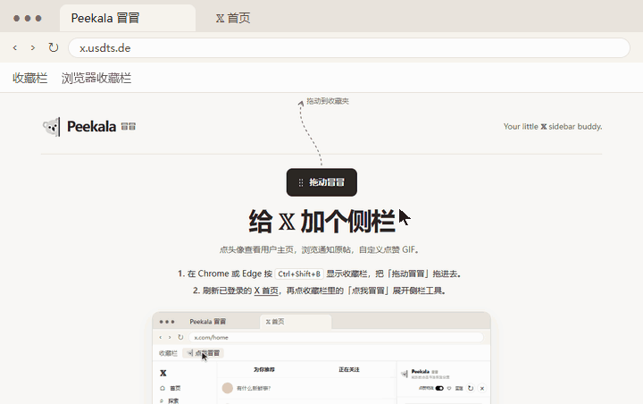

<p align="center">
  
</p>
<h1 align="center">Peekala 冒冒</h1>
<p align="center"><strong>Your little 𝕏 sidebar buddy.</strong></p>
<p align="center">用一枚浏览器书签，为 𝕏 加上用户侧栏和点赞 GIF。</p>
<p align="center">
  <a href="https://x.usdts.de/"><strong>安装冒冒</strong></a> ·
  <a href="#点赞-gif-表情">查看点赞动图</a> ·
  <a href="#安装与使用">使用说明</a>
</p>

## 点赞 GIF 表情

在 X 点赞时，选中的 GIF 会在爱心旁播放。首次使用默认开启特效，播放「冒冒探头」。

<p align="center">
  
</p>

### 系统内置

| 冒冒探头（默认） | 奶龙 | 老黄 |
| :---: | :---: | :---: |
|  |  |  |

| 老马 | 小肥鱼 | 大肥鱼 |
| :---: | :---: | :---: |
|  |  |  |

奶龙表情来自 [Nailoong 官方 GIPHY](https://giphy.com/stickers/transparent-k0XrKqlfnnCSAHWV3F)。

### 换表情或上传 GIF

- **切换表情**。在侧栏顶栏打开「管理」，点缩略图预览，再点「使用此特效」。
- **上传自己的 GIF**。进入「自定义」，点网格里的「＋」。单张最大 10 MB，宽和高各不超过 2048 像素。上传的 GIF 保存在当前浏览器。
- **重播当前特效**。点「点赞特效」左边的粉色爱心。可以连续点击，关闭开关时也能手动预览。
- **删除自定义 GIF**。鼠标移到缩略图上，点左上角的删除图标并确认。删除正在使用的 GIF 会切回「冒冒探头」。

## 安装与使用

1. 在 Chrome 或 Edge 按 <kbd>Ctrl</kbd>+<kbd>Shift</kbd>+<kbd>B</kbd> 显示收藏栏，把安装页上的 **拖动冒冒** 拖进去。[打开安装页](https://x.usdts.de/)
2. 刷新已登录的 X 首页，再点收藏栏里的 **点我冒冒** 展开侧栏。[打开 X 首页](https://x.com/home)

<p align="center">
  
</p>

也可以在浏览器的书签管理器中导入安装。[下载带图标的书签文件](https://x.usdts.de/x-quick-comment-bookmarks.html)

## 侧栏功能

- **查看用户主页**。在 X 首页、通知页、用户主页或帖子页点击头像，右侧会打开对应的用户主页，支持 X 原生回复、转发和引用。
- **查看评论原帖**。原帖已加载时，评论通知下方会显示摘要。
- **使用 X 搜索**。原生搜索建议会浮在侧栏上方。
- **收起或退出**。点顶栏的「×」收起侧栏，再点右侧的冒冒展开。鼠标移到冒冒身上，点右上角的「×」可退出 Peekala。

<details>
<summary><strong>常见问题</strong></summary>

- **站外点击书签会怎样？** 新版书签会询问是否跳转到 X 首页。到达后再点一次书签即可展开侧栏。
- **刷新 X 后怎么恢复？** 再点一次「点我冒冒」，会展开侧栏并恢复点赞特效设置。
- **怎么更新？** 动态书签会短暂打开安装页，从 GitHub 的 `main` 分支加载脚本，失败时使用安装页内置版本。若要更新书签本身，从安装页重新拖入一次。
- **书签点了没反应？** 在 X 页面允许弹窗后重试。侧栏加载卡住时可点「↻」重试，空间不足时可以拉宽窗口。

</details>

<details>
<summary><strong>开发与测试</strong></summary>

```sh
node build.mjs
node test-dynamic-loader.cjs
node test-native-adapter.cjs
```

测试需要 Chromium 和 X bundle，默认从 `%TEMP%/xqc-local-test` 读取，也可通过 `XQC_TEST_ASSETS` 指定目录。

</details>

---

Peekala 取自 Peek（探头）与 Koala（考拉）。[反馈问题](https://github.com/ToTXoX/x-quick-comment/issues) · [MIT 许可证](LICENSE)
